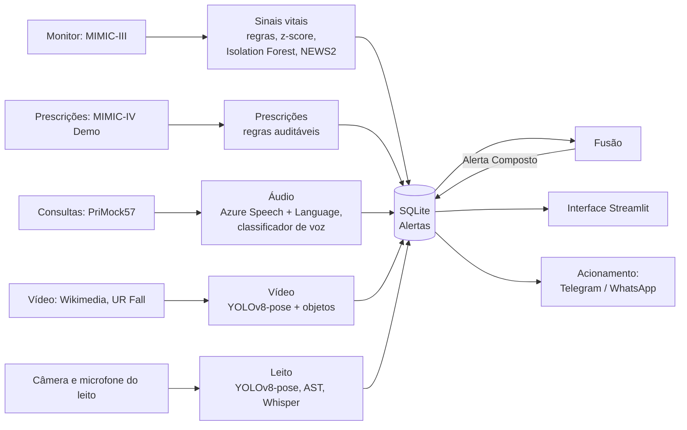

# Monitoramento Multimodal de Pacientes

| Integrante | RM |
| --- | --- |
| Antonio Bazo | 372646 |
| Renato Mattos | 370975 |
| Vinicius Geisler | 373670 |
| Marcelo Costa | 371714 |
| Vinicius Blasque | 370746 |

Tech Challenge da Fase 4 (FIAP, pós-graduação em IA para Devs). O sistema acompanha os pacientes de uma unidade de internação a partir de quatro fontes: **sinais vitais**, **prescrições**, **áudio** (consultas e microfone do leito) e **vídeo** (fisioterapia e câmera do leito). Cada fonte tem um Analisador que transforma o que é preocupante num **Alerta**. Quando fontes diferentes apontam para o mesmo problema, a **Fusão** gera um **Alerta Composto**. A equipe vê tudo numa interface de plantão e é acionada pelo Telegram (ou WhatsApp).

> Não existe base pública com o mesmo paciente em todas as fontes. Por isso, os pacientes da demonstração são **compostos**: cada um junta registros reais de bases públicas diferentes sob uma identidade fictícia ([ADR 0001](docs/adr/0001-paciente-de-demonstracao-composto.md)).

Este README resume o que foi feito e como rodar. Os detalhes estão no [relatório técnico](docs/relatorio_tecnico.md).

## Como rodar

Tudo funciona **sem nenhuma chave do Azure**, exceto analisar no Laboratório um áudio que ainda não foi analisado (ver [Chaves opcionais](#chaves-opcionais-env)). Há três caminhos:

| Caminho | Precisa de | Quando usar |
| --- | --- | --- |
| [Docker](#opção-mais-direta-docker) | Só Docker | Para só rodar e avaliar: dois comandos |
| [Devcontainer](#1-ambiente) | Docker e VS Code | Para rodar e mexer no código |
| [Local](#1-ambiente) | Python 3.12, uv e ffmpeg | Sem Docker |

### Opção mais direta: Docker

O [`Dockerfile`](Dockerfile) da raiz monta uma imagem completa: dependências, dados públicos, lote já processado e modelos baixados.

```bash
git clone https://github.com/fiap-postech-ia-para-devs-grupo/9IADT-fase-4-tech-challenge.git
cd 9IADT-fase-4-tech-challenge
docker build -t monitoramento .              # cerca de 10 min, só na primeira vez
docker run --rm -p 8501:8501 monitoramento
```

Acesse <http://localhost:8501> e pule direto para [O que dá para ver em 5 minutos](#o-que-dá-para-ver-em-5-minutos). Para usar Azure ou Telegram, crie o `.env` (`cp .env.example .env`, preencha) e rode com `docker run --rm -p 8501:8501 --env-file .env monitoramento`. As chaves não entram na imagem. Os Alertas reconhecidos ficam dentro do container: um `docker run` novo começa o plantão do zero.

### 1. Ambiente

Os passos 1 a 4 são para o devcontainer ou para rodar localmente. Foram testados num clone limpo, sem chaves do Azure.

**Devcontainer.** Precisa de Docker e do VS Code (ou outro editor com suporte a devcontainers). O container já traz Python 3.12, uv, ffmpeg e as bibliotecas de sistema do OpenCV e do Azure Speech.

```bash
git clone https://github.com/fiap-postech-ia-para-devs-grupo/9IADT-fase-4-tech-challenge.git
cd 9IADT-fase-4-tech-challenge
cp .devcontainer/.env.example .devcontainer/.env   # obrigatório: o container não sobe sem ele
```

O `.devcontainer/.env` pode ficar vazio (ele guarda só a identidade git de quem desenvolve). Depois, abra a pasta no VS Code e escolha **Reopen in Container**. Ao criar o container, o `post-create.sh` instala as dependências (`uv sync --frozen`) e cria o `.env` a partir do `.env.example`.

**Local.** Precisa de Python 3.12, [uv](https://docs.astral.sh/uv/) e ffmpeg.

```bash
git clone https://github.com/fiap-postech-ia-para-devs-grupo/9IADT-fase-4-tech-challenge.git
cd 9IADT-fase-4-tech-challenge
uv sync --frozen
cp .env.example .env
```

Sem uv, use o `requirements.txt`, exportado do mesmo lock: `pip install -r requirements.txt --extra-index-url https://download.pytorch.org/whl/cpu`. O índice extra é para o `torch` de CPU no Linux.

### 2. Dados (cerca de 1 min)

Os datasets brutos não vão para o git. Este comando baixa o que a demonstração usa (cerca de 40 MB):

```bash
uv run python scripts/download_data.py mimic3wdb mimic4demo video sons
```

Os outros dois datasets, `primock57` e `coswara` (cerca de 3 GB), só são necessários para treinar de novo o classificador de voz (o `primock57` também pede o git-lfs). As respostas do Azure para as consultas do PriMock57 e o modelo treinado já estão versionados.

### 3. Processar tudo e popular o banco (cerca de 5 min em CPU)

```bash
uv run python scripts/run_batch.py
```

O script roda os Analisadores em sequência (sinais vitais, prescrições, áudio, vídeo e Pacientes de Demonstração) e grava os Alertas no SQLite (`data/alertas.db`). No fim, cada etapa deve aparecer como `ok`.

### 4. Abrir a interface

```bash
uv run streamlit run app.py
```

Acesse <http://localhost:8501>. Na primeira vez:

- o **Tour** do sistema abre sozinho (pode fechar e reabrir depois pelo botão 🧭 Tour, no topo);
- escolha o **Plantonista** na barra lateral;
- os modelos YOLOv8, AST e Whisper são baixados e carregados. Isso leva cerca de 2 min e só acontece uma vez.

### Chaves opcionais (.env)

| Variáveis | Para quê | Sem elas |
| --- | --- | --- |
| `AZURE_SPEECH_KEY`, `AZURE_SPEECH_REGION`, `AZURE_LANGUAGE_KEY`, `AZURE_LANGUAGE_ENDPOINT` | Analisar um áudio novo no Laboratório | O lote e os pacientes usam as respostas do Azure versionadas no repositório |
| `TELEGRAM_BOT_TOKEN`, `TELEGRAM_CHAT_ID` | Mandar as chamadas de emergência para um chat do Telegram (bot criado no @BotFather) | Acionamento simulado: registrado no histórico, mas não enviado |
| `EVOLUTION_URL`, `EVOLUTION_APIKEY`, `EVOLUTION_INSTANCE` | Mesmo acionamento, pelo WhatsApp (Evolution API); tem prioridade sobre o Telegram | Idem |
| `APP_URL` | Link da Central de Alertas dentro da mensagem | `http://localhost:8501` |

A criação dos recursos do Azure (tier gratuito F0) está em [docs/azure-setup.md](docs/azure-setup.md). Para alguém receber as chamadas, cadastre o profissional em **Equipe e Leitos**: marque 🔔 e informe um telefone com DDD. Ali também há um botão **Enviar mensagem de teste**.

### Se algo der errado

- **O devcontainer não sobe:** falta o `.devcontainer/.env` (passo 1).
- **"Não há microfone disponível" ou a webcam não abre:** dentro de um container não existe microfone nem câmera. Use os clipes e as gravações de exemplo, que funcionam como a câmera e o microfone do quarto.
- **Uma tela fica vazia:** confira se os passos 2 e 3 terminaram com `ok`.

## O que dá para ver em 5 minutos

1. Escolha o plantonista, a velocidade **5×** e clique em **▶ Iniciar** no relógio do plantão. Cada segundo equivale a 5 minutos do turno.
2. **Mapa de Leitos:** o leito **UCO-12** acende logo no começo, porque o NEWS2 (escala de risco de piora) do paciente subiu. Sem Reconhecimento em 5 minutos do plantão, o chamado escala para a equipe médica.
3. **Prontuário › UTI-04:** cerca de 27 s depois do início, a SpO2 cai para 85% no mesmo minuto em que o paciente diz "short of breath" na consulta. A Fusão gera um **Alerta Composto crítico**.
4. **Central de Alertas:** abra a Evidência, **reconheça** com uma conduta e **resolva**. A luz do leito apaga.
5. **Laboratório de Análise:** analise o clipe `unipodal_valgo` (joelho desviando para dentro no agachamento) e o `queda_02` (queda, com o objeto mais próximo).
6. **Prontuário › Câmera e microfone:** ligue o clipe `queda_01` e a gravação "Enfermeira! Socorro!" para ver a câmera e o microfone do leito acionando a equipe.

### Telas

| Seção | Tela | Para quê |
| --- | --- | --- |
| — | **Início** | Painel do plantão: ocupação, chamados, Alertas por severidade, origem e tipo, NEWS2 por leito, equipe |
| Monitoramento | **Mapa de Leitos** | Um cartão por leito: sinais atuais, NEWS2 e luz de chamada |
| Monitoramento | **Central de Alertas** | Fila única com episódios agrupados, escalonamento, Evidência e Reconhecimento com conduta |
| Paciente | **Admissão** | Dar entrada no paciente e ligar as fontes: monitor, prescrição, consulta e câmera |
| Paciente | **Prontuário** | Monitor de beira de leito, tendências, linha do tempo, medicações, Alertas, câmera e microfone do leito, evolução e alta |
| Análise | **Laboratório de Análise** | Vídeo (clipe, upload ou webcam) e áudio (upload, microfone ou exemplo) analisados na hora |
| Administração | **Equipe e Leitos** | Profissionais e quem recebe chamadas, leitos, canal de acionamento e histórico de envios |
| Administração | **Ajuda** | Como o sistema funciona, o que é real e o que é simulado |

## Como o sistema foi feito



Todos os Analisadores emitem o mesmo **Contrato do Alerta** (`src/core/alerts.py`) e gravam num único SQLite. Os ids são determinísticos, então reprocessar não duplica Alertas.

### Analisadores e resultados

| Fonte | Dados | Técnica | Resultado principal |
| --- | --- | --- | --- |
| Sinais vitais | 10 registros do MIMIC-III Waveform (UTI, 1 ponto por minuto) | Regras clínicas, z-score móvel e Isolation Forest comparados; piora do NEWS2 parcial | Em 23 anomalias injetadas: regras com recall 1,00 e precisão 0,41; Isolation Forest com precisão 0,61, mas 18 min de atraso |
| Prescrições | MIMIC-IV Demo (100 pacientes) | 4 regras auditáveis: salto de dose, droga de alta vigilância, trocas excessivas, duplicidade | 1.355 Alertas. Não há rótulo de "prescrição atípica", então não há precisão a medir |
| Áudio das consultas | 18 consultas do PriMock57 (inglês) | Azure Speech to Text; Text Analytics for Health (sintomas, com negação); Sentiment; classificador de voz (Random Forest) treinado no Coswara | Erro de transcrição (WER) de 0,17; 49 Termos Críticos. Voz: AUC 0,72, mas generaliza mal para consultas e fica fora da Fusão ([ADR 0002](docs/adr/0002-alteracao-vocal-fora-da-fusao.md)) |
| Vídeo | 12 clipes públicos (fisioterapia e quedas) | YOLOv8-pose (17 pontos do corpo) para ângulos e Queda; YOLOv8 de objetos para o local da Queda | 12 de 12 clipes corretos (5 valgos, 5 quedas, nenhum falso positivo); 0,5–0,65 s de CPU por segundo de vídeo |
| Leito (contínuo) | Webcam e microfone, ou gravações tocadas em tempo real | YOLOv8-pose para Queda; AST/AudioSet para alarme, grito e gemido; Whisper para "socorro" | Verificado com gravações rotuladas, sem métrica formal ([ADR 0003](docs/adr/0003-monitoramento-do-leito-e-evento-sonoro.md)) |

O enunciado sugeria o OpenPose. Usamos o YOLOv8-pose, que faz a mesma estimativa de pose, instala com `pip` e roda em CPU.

### Fusão, alertas e acionamento

- **Fusão tardia por regras** (`src/core/fusion.py`): dois Alertas do mesmo paciente, de fontes diferentes, numa janela de 24 h. Regras: insuficiência respiratória (SpO2 + queixa de falta de ar), efeito adverso cardiovascular, Queda associada a medicação e Queda com pedido de ajuda.
- **Plantão simulado:** um relógio único reproduz os dados minuto a minuto, e cada Alerta aparece na hora em que "acontece".
- **Contra a fadiga de alarme:** Alertas repetidos viram um episódio só na Central.
- **Acionamento:** um disparo por leito até o Reconhecimento. Sem resposta em 5 min, escala para a Medicina. O canal pode ser WhatsApp, Telegram ou simulado (`src/core/notificacao.py`).

### Azure

Usamos **Speech** e **Language**, ambos no tier gratuito F0. Como a cota é pequena, cada resposta do Azure é guardada em JSON e versionada. Reprocessar não chama o Azure de novo, e os testes rodam sem chave. Detalhes de uso e cota na seção 6 do relatório.

### Principais limitações

- Os pacientes são compostos, então as coincidências entre fontes são encenadas. A Fusão demonstra o mecanismo, não uma correlação clínica.
- As amostras são pequenas (10 registros, 12 clipes, 18 consultas), e os números servem para comparar técnicas, não para afirmar desempenho clínico.
- O NEWS2 é parcial: não há temperatura, nível de consciência nem O2 suplementar.

## Qualidade: testes e CI

```bash
uv run pytest               # 295 testes
uv run ruff check .         # lint
uv run ruff format --check .
uv run pyright              # checagem de tipos
```

- Os testes cobrem o Contrato do Alerta, o banco, a Fusão, o NEWS2, o acionamento e cada Analisador. Vídeo e pose usam poses sintéticas.
- O Azure é mockado nos testes, então eles rodam sem chave. Os testes que dependem dos dados baixados são pulados quando os dados não estão presentes.
- O **CI** ([GitHub Actions](.github/workflows/ci.yml)) roda os quatro comandos em toda PR e em todo push na `main`, sem segredos e sem baixar dados.
- Um segundo workflow ([docker.yml](.github/workflows/docker.yml)) constrói a imagem do `Dockerfile`, sobe o container e confere que o app responde e que o banco foi populado. Roda quando muda algo que entra na imagem.

## Estrutura

```text
app.py                 interface Streamlit (menu por seções)
Dockerfile             imagem única: dependências, dados, lote e modelos
src/core/              Contrato do Alerta, SQLite, Fusão, NEWS2, Pacientes de Demonstração,
                       cadastros (leitos, equipe, admissões, evolução) e acionamento
src/analyzers/         um Analisador por fonte: video, audio, vitals, prescriptions
src/ui/                telas do Streamlit
scripts/               download, processamento em lote, avaliações e treino
tests/                 testes automatizados (pytest)
data/                  datasets (baixados, fora do git), cache do Azure e Pacientes de Demonstração
results/               métricas, relatórios e evidências de cada fonte
docs/                  relatório técnico, ADRs e setup do Azure
```

## Documentação

| Documento | Conteúdo |
| --- | --- |
| [docs/relatorio_tecnico.md](docs/relatorio_tecnico.md) | Fluxo, modelos, avaliação, exemplos de anomalias, Azure e limitações |
| [docs/adr/](docs/adr/) | Decisões de arquitetura: pacientes compostos, voz fora da Fusão, monitoramento do leito |
| [CONTEXT.md](CONTEXT.md) | Vocabulário do domínio (Alerta, Fusão, Reconhecimento...) |
| [ESTRATEGIA.md](ESTRATEGIA.md) | Plano do projeto, divisão do trabalho e datasets |
| [docs/azure-setup.md](docs/azure-setup.md) | Como criar os recursos do Azure |
| `results/` | Métricas (CSV), relatórios de sessão de vídeo e linhas do tempo de prescrição |
