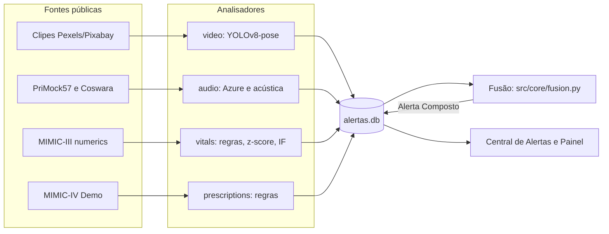

# Relatório Técnico — Tech Challenge Fase 4

> Esqueleto criado no #5. Cada dono escreve a sua seção até o feature freeze (04/11/2026); Renato revisa e costura.
> Vocabulário oficial em [CONTEXT.md](../CONTEXT.md). Estrutura definida em [ESTRATEGIA.md](../ESTRATEGIA.md), seção 13.

| Seção | Dono | Issue |
| --- | --- | --- |
| 1. Contexto | Renato | #17 |
| 2. Fluxo Multimodal | Antonio | #11 |
| 3.1 Vídeo | Marcelo | #6, #13 |
| 3.2 Áudio | V. Geizler | #9, #10, #14 |
| 3.3 Sinais Vitais | Antonio | #7 |
| 3.4 Prescrições | V. Blasque | #8 |
| 4. Fusão e Pacientes de Demonstração | V. Blasque | #12 |
| 5. Resultados e Exemplos de Anomalias Detectadas | cada dono, nas suas seções; Renato consolida | #17 |
| 6. Integração com Azure | V. Geizler | #14, #21 |
| 7. Limitações | Renato, com insumo de cada dono | #17 |
| 8. Conclusão e Trabalhos Futuros | Renato | #17 |

## 1. Contexto (continuidade com o assistente da Fase 3)

_Dono: Renato._ <!-- TODO -->

## 2. Fluxo Multimodal

_Dono: Antonio._

Cada modalidade tem o seu Analisador, que lê uma fonte pública e emite Alertas no mesmo Contrato do Alerta (`src/core/alerts.py`). Os Alertas vão para um único SQLite (`src/core/db.py`). A Fusão lê esse banco, cruza Alertas de modalidades diferentes do mesmo Paciente de Demonstração numa janela de 24 horas e grava os Alertas Compostos. A Central de Alertas é a única tela em que a equipe vê e reconhece os Alertas.



**Monitoramento contínuo.** Os sinais vitais não são analisados em lote. O `src/analyzers/vitals/stream.py` reproduz o registro minuto a minuto (1 minuto de dado por segundo de parede, por padrão) e grava cada Alerta no banco no instante em que a Anomalia aparece pela primeira vez. Isso é o que a Tela 2 vai mostrar ao vivo. O replay sem pausa (`scripts/replay_vitals.py`) grava o mesmo conjunto de Alertas, sem esperar.

**Identidade dos Alertas.** Os ids são determinísticos (UUID v5 a partir do conteúdo da Anomalia), então rodar de novo o mesmo registro não duplica Alertas. Isso faz do banco um resultado reprodutível, e não um acúmulo de execuções.

**Limite da Fusão.** Os Pacientes de Demonstração são compostos (ver seção 4). Os Alertas de origens diferentes vêm de registros de bases públicas distintas, então a Fusão mostra a regra e a janela, não uma correlação clínica real.

## 3. Modelos por Tipo de Dado

### 3.1 Vídeo — YOLOv8-pose, Desvio de Execução, Queda

_Dono: Marcelo._ <!-- TODO -->

### 3.2 Áudio — Azure STT + TA for Health + classificador acústico

_Dono: V. Geizler._

**Dados.** Canal do paciente de 18 Consultas do PriMock57 (4–5 por dia dos 5 dias de gravação, `data/audio/primock57_selecionadas.txt`) — áudio já em WAV 16 kHz mono e a transcrição manual (`.TextGrid`) usada como referência do WER. Subset do Coswara (`data/audio/coswara_pastas_selecionadas.txt`): 17 das ~43 pastas do repositório, escolhidas por densidade de rótulo (pessoas com `bd`/`ftg` por MB baixado), já que o dataset não tem um subset pequeno pronto e os rótulos de interesse estão espalhados de forma desigual entre as pastas. Rationale completo de cada escolha nos próprios arquivos de seleção.

**Camada semântica** (`src/analyzers/audio/semantic.py`, ESTRATEGIA.md seção 5):

1. `converter_wav`: WAV 16 kHz mono (`pydub`/`ffmpeg`), idempotente.
2. `transcrever`: Azure Speech to Text (`en-US`), reconhecimento contínuo com timestamp por trecho, **cacheado em JSON** (`src/analyzers/audio/cache.py`) — reprocessar a mesma Consulta lê o cache em vez de gastar cota.
3. `calcular_wer`: WER (`jiwer`) contra o `.TextGrid` manual, normalizando as duas transcrições (minúsculas, sem pontuação, sem as tags `<UNSURE>`/`<UNIN/>` do PriMock57).
4. `extrair_entidades_saude`: Text Analytics for Health, em lotes de até 25 trechos, cacheado.
5. `termos_criticos`: entidades `SymptomOrSign`/`Diagnosis` × lista curada (`src/analyzers/audio/termos.py`) → Alerta `termo_critico`, só para sintomas afirmados sobre o próprio paciente, com o trecho e o `inicio` (segundos desde o começo da Consulta) como Evidência; `categoria` (`respiratorio`/`dor`) só é preenchida nos termos que a Fusão usa (ESTRATEGIA.md, seção 8).
6. `analisar_sentimento`: Sentiment por trecho do paciente, cacheado.

**Camada acústica** (`src/analyzers/audio/acoustic.py`, ESTRATEGIA.md seção 6): features de `counting-normal.wav` e `vowel-a.wav` — MFCC (média/desvio de 13 coeficientes), F0, jitter, shimmer, HNR (`parselmouth`), proporção de pausas e taxa de fala (proxy por transições silêncio→fala sobre a energia RMS, `librosa`). As duas gravações entram como amostras independentes do mesmo rótulo (não concatenadas por pessoa): é o que permite aplicar o mesmo extrator depois sobre um áudio de fala livre, na inferência.

**Treino e avaliação** (`scripts/treinar_acustico.py`). Rótulo por pessoa a partir de `combined_data.csv`: 1 = `bd` (Breathing Difficulties) ou `ftg` (Fatigue), 0 = `healthy` sem nenhum dos dois. Das 1.163 pessoas rotuladas com áudio extraído, balanceei até 300 por classe (300 sintomáticas / 245 saudáveis — menos saudáveis disponíveis nas pastas escolhidas) → 1.067 gravações. Split 75/25 **por pessoa** (as duas gravações da mesma pessoa nunca ficam uma no treino e outra no teste, para não vazar informação do indivíduo entre os dois).

| Modelo | AUC | F1 | Limiar | VN | FP | FN | VP |
| --- | --- | --- | --- | --- | --- | --- | --- |
| Regressão Logística | 0,705 | 0,715 | 0,535 | 64 | 55 | 36 | 114 |
| Random Forest | 0,721 | 0,719 | 0,573 | 80 | 39 | 44 | 106 |

Resultados em `results/audio/acoustic_metricas.csv` e `results/audio/acoustic_resumo.json`. O **limiar** de cada modelo é a estatística J de Youden (maximiza sensibilidade + especificidade − 1), calculada com previsões fora da dobra no treino (validação cruzada em 5 dobras, por pessoa), nunca no teste: escolhê-lo no teste inflaria o F1 e a matriz de confusão. O J equilibra os dois erros, já que não há custo clínico definido para favorecer um lado. O **Random Forest** (maior AUC no teste, o que torna essa escolha levemente otimista) é o modelo persistido (`data/audio/modelo_acustico.joblib`) e usado na inferência.

**Inferência no PriMock57** (mesmo script): rodar o classificador sobre a fala do paciente das 18 Consultas, sem precisar do Azure. Resultado em `results/audio/alteracao_vocal_primock57.csv` — probabilidade e se passou do limiar, por Consulta; quando passa, `src/analyzers/audio/acoustic.py::alerta_alteracao_vocal` grava um Alerta `alteracao_vocal`.

**Função do Laboratório** (`src/analyzers/audio/lab.py::analyze_audio`, #14): roda as duas camadas sobre um áudio qualquer e devolve transcrição, Termos Críticos, Sentimento, métricas acústicas e probabilidade de Alteração Vocal, com os Alertas já no Contrato — chamada pela Tela 3 (`src/ui/laboratorio.py`).

**Testes** (`uv run pytest tests/test_audio_*.py tests/test_laboratorio.py`): Azure **mockado** (nenhum teste chama a rede) — `_reconhecer_continuo`, `_extrair_entidades_azure` e `_analisar_sentimento_azure` são substituídos por funções falsas, e o cache é testado separadamente. `converter_wav` e a extração de features acústicas usam `ffmpeg`/`librosa`/`parselmouth` de verdade sobre áudio sintético gerado no teste (tom puro, silêncio), não dados reais. O parser de `.TextGrid`, o cálculo de WER, a busca de Termos Críticos e a geração de Alertas (determinismo, formato do Contrato) são testados com dados fixos.

**Leitura dos números e limitações** (ver também seção 7):

- **Desempenho moderado.** AUC ~0,7 era esperado: a ESTRATEGIA.md já previa "desempenho fraco (AUC ~0,6)" como risco aceito, e o valor está no pipeline reprodutível, não no número. O F1 precisa ser lido com cuidado: com 150 gravações positivas e 119 negativas no teste, marcar tudo como positivo já daria F1 0,716, praticamente igual ao dos dois modelos. Os falsos negativos (36–44) importariam clinicamente: o limiar de Youden não prioriza recall.
- **Treino e inferência vêm de tipos de fala diferentes.** O classificador aprende em `counting-normal`/`vowel-a` (fala controlada, curta) e infere sobre consulta espontânea (PriMock57); é a limitação explícita da ESTRATEGIA.md seção 5 ("as camadas são avaliadas em datasets diferentes"). Na prática, isso aparece como viés: 17 das 18 Consultas passam do limiar de Alteração Vocal (seção 5), evidência de desalinhamento de domínio, não de que quase todo paciente tenha o padrão.
- **Subset do Coswara reduzido por tempo/banda desta sessão.** 545 pessoas, não as 300–600 **por classe** da ESTRATEGIA.md (ficou 300 sintomáticas / 245 saudáveis). `data/audio/coswara_pastas_selecionadas.txt` documenta como escalar para mais pastas.
- **Falsos alertas de Termo Crítico.** Numa revisão manual dos 49 Alertas, sem medida formal de precisão, 6 são duvidosos ou errados (seção 5). Falta rótulo de referência para calcular precisão e recall da camada semântica.

**Como rodar.**

```bash
uv run python scripts/download_data.py primock57 coswara
uv run python -m scripts.treinar_acustico             # métricas + modelo + inferência no PriMock57
uv run python -m scripts.processar_audio_semantico    # requer .env (docs/azure-setup.md)
uv run pytest tests/test_audio_*.py tests/test_laboratorio.py
```

### 3.3 Sinais Vitais — regras × z-score × Isolation Forest

_Dono: Antonio._

**Dado.** 10 registros *numerics* do MIMIC-III Waveform Database (`mimic3wdb/1.0`, acesso aberto), lidos com `wfdb` e reamostrados para 1 minuto (`src/analyzers/vitals/load.py`). Cada registro tem entre 100 e 330 minutos. Foram escolhidos pelo critério: até 50% de lacunas em FC, FR, SpO2 e PAS, e pelo menos 3 janelas limpas de 40 minutos sem lacuna. Lacunas de até 5 minutos são interpoladas; as maiores ficam como ausência de dado. Os registros são curtos e irregulares, o que limita a amostra (ver seção 7).

**Técnicas** (`src/analyzers/vitals/detectors.py`, mesma interface `detect(janela) -> Alerta[]`):

- **Regras clínicas:** SpO2 < 90 (crítica), FC > 120 ou < 45, PAS > 180 ou < 90, FR > 25.
- **z-score móvel:** |x − média| > 3σ sobre os 60 minutos anteriores, com desvio mínimo de 5 bpm (FC), 3 rpm (FR), 2 pontos (SpO2) e 10 mmHg (PAS). O desvio mínimo evita que séries muito estáveis gerem falsos positivos.
- **Isolation Forest:** sobre médias móveis de 5 minutos das quatro séries, 200 árvores, contaminação de 1%.

**Avaliação** (`scripts/avaliar_vitals.py`). Em cada registro, injetamos uma Anomalia de cada tipo (pico de FC, queda gradual de SpO2, hipotensão súbita) com 20 minutos de duração, fora de trechos já marcados pelas regras e pelo z-score. Foram 23 injeções no total, pois nem todos os tipos couberam em todos os registros. Um Alerta cobre uma injeção quando a série bate e os intervalos se cruzam, com tolerância de 5 minutos.

| Técnica | Recall | Precisão | Alertas | Atraso mediano |
| --- | --- | --- | --- | --- |
| Regras clínicas | 1,00 (23/23) | 0,41 | 64 | 0 min |
| z-score móvel | 0,70 (16/23) | 0,19 | 90 | 0 min |
| Isolation Forest | 0,48 (11/23) | 0,61 | 18 | 18 min |

Resultados em `results/vitals/avaliacao.csv` (agregado) e `results/vitals/avaliacao_por_registro.csv`.

**Leitura dos números.** As regras acertam todas as injeções porque os eventos foram desenhados para cruzar exatamente os limites clínicos, então esse recall é otimista. A precisão baixa das regras não é só erro: os Alertas "falsos" contam Anomalias reais que já estavam nos registros (ex.: SpO2 de 76% no registro 3000100n). O z-score detecta mais tipos de desvio, mas gera muitos alertas sobre variações pequenas. O Isolation Forest é o mais preciso, com menos alertas, mas detecta menos e com atraso de cerca de 18 minutos, porque só marca um padrão conjunto depois que a média móvel se afasta da história.

No replay (`scripts/replay_vitals.py`), os 10 registros geraram 239 Alertas `sinal_vital` gravados no SQLite.

### 3.4 Prescrições — regras sobre MIMIC-IV Demo

_Dono: V. Blasque._

**Dado.** MIMIC-IV Clinical Database Demo 2.2 (ODbL, acesso aberto): `hosp/prescriptions` (18.087 linhas, 100 pacientes, 250 internações com prescrição) e `hosp/emar`, mais `admissions` para a alta de cada internação. Só entram prescrições de terapia (`drug_type = MAIN`), sem as soluções de manutenção de acesso (_flush_/_lock_); prescrição sem `stoptime` termina na alta. `scripts/download_data.py mimic4demo` baixa tudo; os dados brutos não vão para o git.

**Técnica.** Regras determinísticas, sem aprendizado: o MIMIC não traz rótulo de "prescrição atípica", então não há precisão/recall a medir. O valor está em regras auditáveis, cada Alerta citando a regra e os dados que o dispararam (`evidencia`). Isolation Forest ficou como trabalho futuro (ESTRATEGIA.md, seção 7).

| Regra | Dispara quando | Severidade |
| --- | --- | --- |
| `salto_de_dose` | mesma droga, via e unidade, dose nova > 1,5× a anterior com início em < 24h | alta se a droga é de alta vigilância, senão média |
| `alta_vigilancia` | primeira prescrição de cada classe de alta vigilância (anticoagulante, insulina, opioide, sedativo) na internação | alta para opioide e anticoagulante, média nas demais |
| `trocas_excessivas` | mais de 4 trocas de princípio ativo dentro da mesma classe em 48h (um Alerta por episódio) | baixa |
| `duplicidade` | dois princípios ativos diferentes da mesma classe com vigências sobrepostas (um Alerta por par e internação) | alta se envolve alta vigilância, senão média |

**Listas versionadas** (`src/analyzers/prescriptions/listas.py`, `VERSAO = "1.0.0"`; toda Evidência registra a versão): drogas de alta vigilância, 10 classes terapêuticas para duplicidade/trocas, lista de reposição de eletrólitos e lista de rotina. A unidade de comparação é o princípio ativo, então metoprolol _tartrate_ e _succinate_ não são duplicidade.

**Decisões de projeto** (todas declaradas aqui porque mudam a contagem):

- Reposição de eletrólitos e glicose (Mg, Ca, K, fosfato, NaCl, bicarbonato, dextrose) fica fora de `salto_de_dose`: é titulada por exame, então a dose oscila por rotina. Sem essa exclusão, a regra gerava 674 Alertas (93% dos pacientes), dominados por magnésio, cálcio e potássio; com ela, 444.
- Heparina + varfarina (ponte de anticoagulação), insulina basal + rápida e AAS + clopidogrel são esquemas padrão e não entram em `duplicidade`.
- "Suspensão" não entra em `trocas_excessivas`: o MIMIC só registra o `stoptime` prescrito, não o momento real da suspensão. Conta-se a troca de princípio ativo dentro da classe.
- O eMAR confirma `alta_vigilancia`: a Evidência traz `primeira_administracao`, a primeira dose de fato administrada.
- Os ids dos Alertas são determinísticos (UUIDv5), então reprocessar não duplica nada no SQLite.

**Resultado nos 100 pacientes** (`results/prescriptions/contagem_por_regra.csv`, listas v1.0.0):

| Regra | Alertas | Pacientes com ao menos 1 |
| --- | --- | --- |
| `salto_de_dose` | 444 | 81 |
| `alta_vigilancia` | 652 | 99 |
| `trocas_excessivas` | 16 | 11 |
| `duplicidade` | 243 | 69 |
| **Total** | **1.355** | |

**Linhas do tempo** (`results/prescriptions/linha_do_tempo_*.html`, gráfico interativo com as prescrições monitoradas e os Alertas sobre a droga de cada um): internações com mais regras distintas disparadas.

- Paciente 10014729, internação 28889419: os quatro tipos de Alerta, por exemplo "Duplicidade terapêutica (opioide): Meperidine e Oxycodone-Acetaminophen ativas ao mesmo tempo" e "5 trocas de medicação em 48h".
- Paciente 10032725, internação 25177949: "Aumento de dose > 50% em < 24h: HYDROmorphone (Dilaudid) 2 → 6 mg" e "Duplicidade terapêutica (opioide): HYDROmorphone e Oxycodone SR ativas ao mesmo tempo".

**Leitura dos números e limitações.** O demo é majoritariamente de UTI, então quase todo paciente inicia uma droga de alta vigilância (99%): a regra mostra o mecanismo, não discrimina risco, e numa enfermaria teria taxa bem menor. Os limiares (1,5×, 24h, 4 trocas, 48h) vêm da ESTRATEGIA.md ou foram escolhidos olhando a distribuição do próprio demo; não houve validação clínica. As listas de drogas são curadas à mão para o escopo do trabalho, não um formulário completo. As datas do MIMIC são deslocadas (anos 21xx); o alinhamento com as outras modalidades é feito pelos offsets dos Pacientes de Demonstração (seção 4).

**Como rodar.**

```bash
uv run python scripts/download_data.py mimic4demo
uv run python -m scripts.analisar_prescricoes --gravar   # contagem, linhas do tempo e Alertas no SQLite
uv run pytest tests/test_prescriptions.py
```

## 4. Fusão e Pacientes de Demonstração

_Dono: V. Blasque._ Declarar que os pacientes são compostos para demonstração ([ADR 0001](adr/0001-paciente-de-demonstracao-composto.md)). <!-- TODO -->

## 5. Resultados e Exemplos de Anomalias Detectadas

_Dono: cada um nas suas seções; Renato consolida._

### Sinais vitais (Antonio)

Exemplos reais, nos registros do MIMIC-III listados em `data/vitals/selecionados.txt`. Horários são simulados, a partir de 2150-01-01 00:00, como no `load.py`.

- **Dessaturação grave (regra clínica, crítica).** Registro `3000100n`: SpO2 de 79,4% e 76,6% em dois minutos consecutivos, entre 01:22 e 01:23. Alerta: "SpO2 < 90 por 2 min", severidade crítica. É a Anomalia real mais clara dos registros, e a equipe precisaria ser avisada.
- **Hipertensão sustentada (regra clínica, alta).** Registro `3000100n`: PAS de 186 mmHg por quatro minutos, entre 02:11 e 02:14. Alerta: "PAS > 180 por 4 min", severidade alta.
- **Bradicardia isolada (regra clínica, alta).** Registro `3000100n`: FC de 44,9 bpm durante um minuto, às 02:35. Alerta: "FC < 45 por 1 min". Por ser de um minuto, pode ser artefato de medida; a equipe confirma no leito.
- **Desvio em relação à própria história (z-score, média).** Registro `3002751n`: FC 3,6σ acima da média dos 60 minutos anteriores, entre 01:46 e 01:47. O z-score pega variações que não cruzam nenhum limite clínico, mas também gera Alertas sobre oscilações pequenas, por isso a precisão dele é a mais baixa (ver seção 3.3).

Para os números da avaliação com anomalias injetadas (recall, precisão e atraso por técnica), ver a seção 3.3 e `results/vitals/`.

### Áudio (V. Geizler)

Inferência real do classificador acústico (Random Forest, AUC 0,721, limiar 0,573 — seção 3.2) sobre a fala do paciente nas 18 Consultas do PriMock57, sem depender do Azure (`results/audio/alteracao_vocal_primock57.csv`):

- **17 de 18 Consultas** passaram do limiar (probabilidades entre 0,60 e 0,87) — ex.: `day5_consultation02` com 0,867, `day1_consultation01` com 0,667.
- Só `day3_consultation01` (0,493) ficou abaixo.

Esse resultado **não deve ser lido como "quase todo paciente do PriMock57 tem Alteração Vocal"**: é evidência do desalinhamento de domínio já apontado na seção 3.2 — o classificador, treinado em gravações curtas e controladas (contagem, vogal sustentada) do Coswara, generaliza mal para fala espontânea de consulta e tende a marcar positivo. Fica registrado como achado honesto, não como resultado clínico (ver seção 7). Por isso, a Alteração Vocal fica fora da Fusão ([ADR 0002](adr/0002-alteracao-vocal-fora-da-fusao.md)): um Alerta que dispara em quase toda Consulta não confirma nada.

**Camada semântica**, executada de verdade no Azure sobre as mesmas 18 Consultas (`results/audio/wer.csv` e `results/audio/termos_criticos.csv`):

| Medida | Resultado |
| --- | --- |
| WER médio, bruto | 0,218 (0,106 a 0,326 por Consulta) |
| WER médio, sem hesitações | 0,171 (0,092 a 0,292 por Consulta) |
| Termos Críticos | 49, em 15 Consultas: 12 respiratórios, 11 de dor, 26 sem categoria da Fusão |
| Consultas com Termo Crítico respiratório | 7 |

A transcrição manual registra hesitações ("um", "uh") que o Azure quase sempre omite: em `day1_consultation01`, são 52 contra 3. Elas não afetam nenhum Termo Crítico, então o WER sem hesitações é a leitura principal, com o bruto ao lado para transparência. Números escritos em dígitos pelo Azure ("6" contra "six") ainda contam como erro nas duas medidas.

Sintomas negados ou atribuídos a terceiros, conforme marcados pela TA for Health, não geram Alerta ("No fever at all"). A marcação não é perfeita: numa revisão manual dos 49 Alertas, sem rótulo de referência, 6 são duvidosos ou errados, por exemplo "one child was vomiting", "I don't feel like I'm feverish" e "Cold chest pain out of pain", este último um erro de transcrição. Erros de reconhecimento também causam perdas: "shortness of breath" foi transcrito como "assurance of breath" e "sure of breath". Todos os 12 respiratórios revisados têm base na fala do paciente, ainda que "difficult breathing" (`day3_consultation01`) se refira a um episódio passado.

## 6. Integração com Azure (serviços, custos, cotas)

_Dono: V. Geizler._ Setup completo, cotas F0 e Plano B em [azure-setup.md](azure-setup.md) (#4); conta e recursos criados no #21, com o smoke test passando nos três serviços em 05/11/2026.

**Serviços.** **Speech** (Speech to Text, `en-US`, reconhecimento contínuo com timestamp) e **Language** (Text Analytics for Health + Sentiment), ambos tier **F0** (gratuito): 5h/mês de STT e 5.000 registros/mês de Language, compartilhados pelo time inteiro numa única chave.

**Orçamento de cota usado pelo Analisador de Áudio:**

| Uso | Custo estimado |
| --- | --- |
| Batch de 18 Consultas (canal do paciente) | 2,57 h de STT (a cota conta a duração do arquivo, não só a fala); 1.043 trechos: ~1.043 registros de Sentiment e ~2.086 de TA for Health, que precisou rodar duas vezes para guardar negação e sujeito |
| Smoke test (`scripts/azure_smoke_test.py`) | ~10 s de STT + 2 registros de Language |
| Upload no Laboratório (por análise) | 1 arquivo de STT + 1 registro de Language por trecho transcrito |

Isso consome cerca de metade das 5 h de STT e cerca de 3.100 dos 5.000 registros mensais. Sobra margem para a demo e a gravação do vídeo, mas sem espaço para repetir o batch sem o cache (ESTRATEGIA.md, seção 15). O F0 aceita uma transcrição por vez: duas pessoas não transcrevem ao mesmo tempo com a mesma chave.

**Protegendo a cota.** Toda resposta do Azure (STT, TA for Health, Sentiment) é cacheada em JSON por `src/analyzers/audio/cache.py` (`obter_ou_computar`), em `data/audio/cache_primock57/` (batch) ou `data/audio/cache_laboratorio/` (upload): reprocessar o mesmo áudio lê o cache e não chama o Azure de novo. Isso é o que permite rodar `uv run pytest` e `scripts/treinar_acustico.py` (camada acústica) sem tocar a cota nenhuma vez — só `scripts/processar_audio_semantico.py` e o upload na Tela 3 chamam o Azure de fato, e só na primeira vez por arquivo. O cache do batch é versionado no git, sem os WAVs, para que o time e os avaliadores reproduzam os resultados sem gastar cota.

**Estado:** executado de verdade contra o Azure nas 18 Consultas; os testes automatizados seguem com Azure mockado. Rodar com o Azure real expôs o que os mocks escondiam, como o limite de 10 documentos por chamada de Sentiment.

## 7. Limitações (datasets distintos, pacientes compostos, dados em inglês)

_Dono: Renato, com insumo de cada dono._

**Sinais vitais (Antonio):**

- **Amostra pequena.** São 10 registros de 100 a 330 minutos, com até 50% de lacunas, e uma injeção de cada tipo por registro. Os números da avaliação têm pouca base estatística; servem para comparar técnicas, não para afirmar desempenho clínico.
- **Critério de seleção próprio.** Os registros foram escolhidos por lacunas e janelas limpas, critério definido pelo time porque o PDF não especifica nenhum. Isso pode favorecer registros mais "limpos" do que a população real de UTI.
- **Anomalias injetadas são artificiais.** Os eventos injetados cruzam exatamente os limites clínicos, o que favorece as regras. O recall das regras é otimista e não deve ser lido como capacidade de detecção em produção.
- **Anomalias naturais contam como falso positivo.** A precisão baixa das regras inclui Anomalias reais que já estavam nos registros. Sem rótulo clínico, não dá para separar erro de detecção de anomalia verdadeira.
- **Registros de 1 minuto.** A resolução é de um ponto por minuto. Eventos de poucos segundos, como uma arritmia breve, não são capturados.

**Áudio (V. Geizler):**

- **Termos Críticos sem medida formal de precisão e recall.** Não há rótulo de referência no PriMock57: a revisão manual achou 6 Alertas duvidosos ou errados em 49 (seção 5). A lista curada também limita o recall: variantes como "pain in my chest" não casam.
- **Treino e inferência acústica vêm de tipos de fala diferentes.** O classificador é treinado em `counting-normal`/`vowel-a` do Coswara (fala controlada, curta) e infere sobre a fala espontânea de uma Consulta (PriMock57) ou de um upload qualquer; é uma limitação de desenho, não um bug — já prevista na ESTRATEGIA.md, seção 5. Na inferência real sobre as 18 Consultas do PriMock57, 17 passaram do limiar (seção 5): é desalinhamento de domínio, não um sinal clínico real.
- **AUC moderado (~0,7) e F1 próximo do trivial.** O AUC era esperado desde a ESTRATEGIA.md (seção 15, risco aceito); o F1 de 0,719 fica perto dos 0,716 de marcar tudo como positivo. O valor do classificador está em ter um pipeline reprodutível com métrica real, não em alta acurácia; os falsos negativos do limiar de Youden importariam clinicamente numa aplicação real.
- **Subset do Coswara menor que o alvo.** 545 pessoas (300 sintomáticas / 245 saudáveis), não as 300–600 **por classe** da ESTRATEGIA.md: o dataset distribui os rótulos de interesse de forma muito desigual entre as pastas (ver rationale em `data/audio/coswara_pastas_selecionadas.txt`), e baixar mais pastas custaria bandwidth/tempo além do orçado nesta frente.
- **Dados em inglês, de dois contextos diferentes.** PriMock57 é consulta simulada (ator, não paciente real); Coswara é rastreamento de COVID-19, não triagem geral de dificuldade respiratória/fadiga — a Alteração Vocal detectada não tem validação clínica própria.

## 8. Conclusão e Trabalhos Futuros

_Dono: Renato._ AWS Textract/Comprehend, OpenAI, TORGO, notificação externa. <!-- TODO -->
