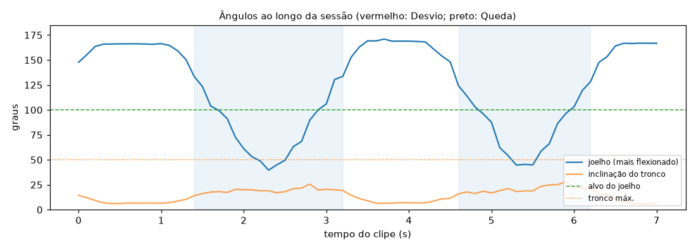

# Relatório de Sessão — agachamento_costas

- **Arquivo:** `Squat_-_exercise_demonstration_video.webm`
- **Paciente:** avulso
- **Cenário:** Agachamento
- **Vista da câmera:** frontal
- **Duração:** 7.1 s (213 frames a 30 fps; pose em 1 a cada 3)
- **Processamento em CPU:** 4.3 s (0.60× o tempo do clipe)
- **Frames com pessoa detectada:** 100%

## Repetições (2)

| # | trecho | joelho no fundo |
| --- | --- | --- |
| 1 | 1.4–3.2 s | 40° |
| 2 | 4.6–6.2 s | 45° |

## Desvios de Execução (0)

Nenhum Desvio de Execução: execução dentro da faixa esperada.

## Quedas (0)

Nenhuma Queda detectada.

## Ângulos ao longo do tempo

_Gerado automaticamente pelo Analisador de Vídeo (YOLOv8n-pose). Limiares em `src/analyzers/video/exercise_rules.py` e `fall.py`._
