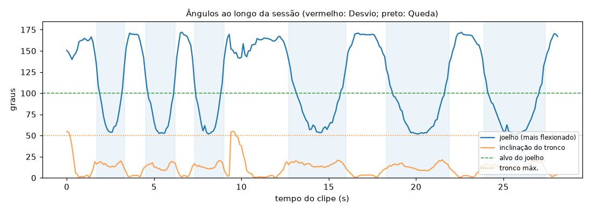

# Relatório de Sessão — agachamento_lateral

- **Arquivo:** `Squat_and_Frontal_Raise.webm`
- **Paciente:** demo-02
- **Cenário:** Agachamento
- **Vista da câmera:** lateral
- **Duração:** 28.2 s (846 frames a 30 fps; pose em 1 a cada 3)
- **Processamento em CPU:** 17.8 s (0.63× o tempo do clipe)
- **Frames com pessoa detectada:** 100%

## Repetições (6)

| # | trecho | joelho no fundo |
| --- | --- | --- |
| 1 | 1.7–3.3 s | 54° |
| 2 | 4.5–6.2 s | 52° |
| 3 | 7.3–9.0 s | 52° |
| 4 | 12.7–16.0 s | 53° |
| 5 | 18.3–21.9 s | 52° |
| 6 | 23.9–27.4 s | 50° |

## Desvios de Execução (0)

Nenhum Desvio de Execução: execução dentro da faixa esperada.

## Quedas (0)

Nenhuma Queda detectada.

## Ângulos ao longo do tempo

_Gerado automaticamente pelo Analisador de Vídeo (YOLOv8n-pose). Limiares em `src/analyzers/video/exercise_rules.py` e `fall.py`._
