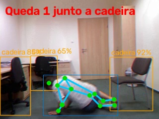
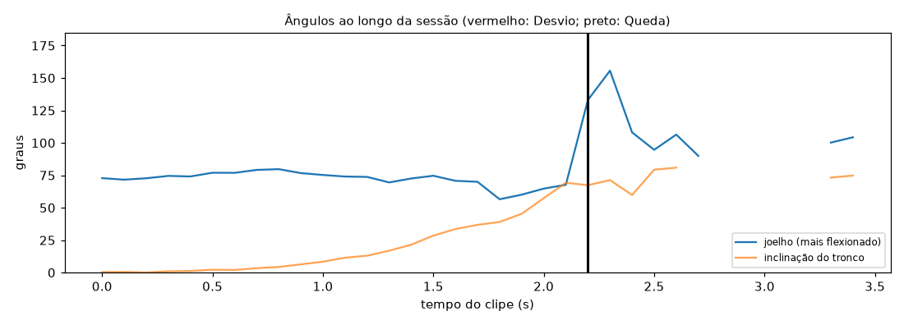

# Relatório de Sessão — queda_02

- **Arquivo:** `fall-02-cam0.mp4`
- **Paciente:** demo-03
- **Cenário:** quarto (monitoramento de Queda)
- **Vista da câmera:** lateral
- **Duração:** 3.7 s (110 frames a 30 fps; pose em 1 a cada 3)
- **Processamento em CPU:** 2.1 s (0.57× o tempo do clipe)
- **Frames com pessoa detectada:** 97%

## Quedas (1)

| no chão em | transição | largura/altura | altura vs. em pé | junto a |
| --- | --- | --- | --- | --- |
| 2.2 s | 0.6 s | 1.81 | 48% | cadeira |

## Evidências

**Queda 1**

## Ângulos ao longo do tempo

_Gerado automaticamente pelo Analisador de Vídeo (YOLOv8n-pose). Limiares em `src/analyzers/video/exercise_rules.py` e `fall.py`._
