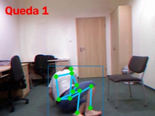
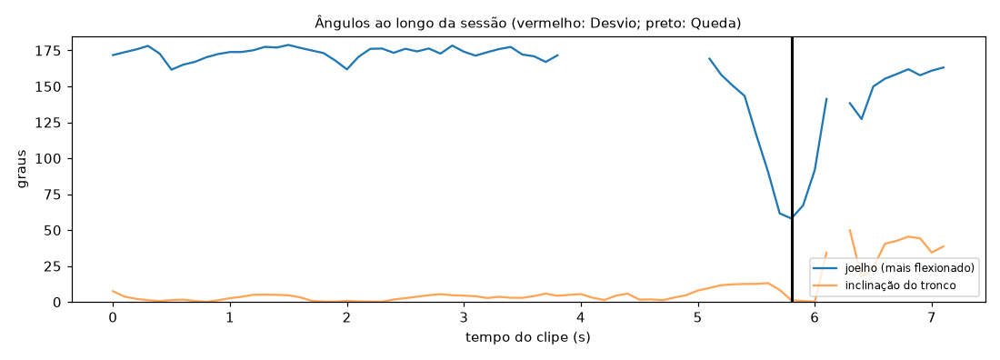

# Relatório de Sessão — queda_03

- **Arquivo:** `fall-03-cam0.mp4`
- **Paciente:** avulso
- **Cenário:** quarto (monitoramento de Queda)
- **Vista da câmera:** lateral
- **Duração:** 7.2 s (215 frames a 30 fps; pose em 1 a cada 3)
- **Processamento em CPU:** 4.4 s (0.61× o tempo do clipe)
- **Frames com pessoa detectada:** 99%

## Quedas (1)

| no chão em | transição | largura/altura | altura vs. em pé |
| --- | --- | --- | --- |
| 5.8 s | 0.5 s | 1.08 | 44% |

## Evidências

**Queda 1**

## Ângulos ao longo do tempo

_Gerado automaticamente pelo Analisador de Vídeo (YOLOv8n-pose). Limiares em `src/analyzers/video/exercise_rules.py` e `fall.py`._
