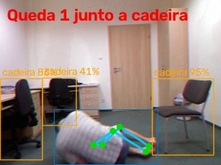
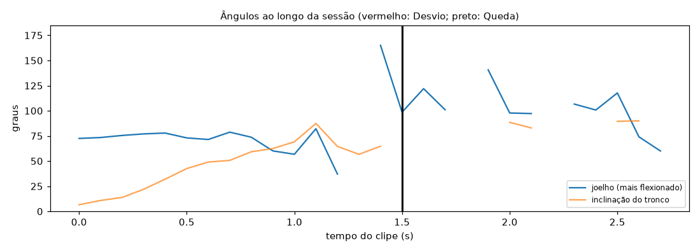

# Relatório de Sessão — queda_04

- **Arquivo:** `fall-04-cam0.mp4`
- **Paciente:** avulso
- **Cenário:** quarto (monitoramento de Queda)
- **Vista da câmera:** lateral
- **Duração:** 3.2 s (96 frames a 30 fps; pose em 1 a cada 3)
- **Processamento em CPU:** 2.0 s (0.61× o tempo do clipe)
- **Frames com pessoa detectada:** 100%

## Quedas (1)

| no chão em | transição | largura/altura | altura vs. em pé | junto a |
| --- | --- | --- | --- | --- |
| 1.5 s | 1.2 s | 1.88 | 47% | cadeira |

## Evidências

**Queda 1**

## Ângulos ao longo do tempo

_Gerado automaticamente pelo Analisador de Vídeo (YOLOv8n-pose). Limiares em `src/analyzers/video/exercise_rules.py` e `fall.py`._
