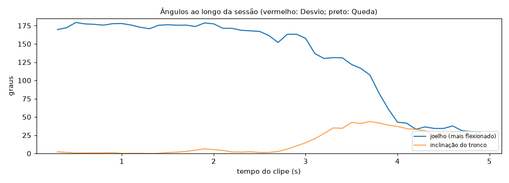

# Relatório de Sessão — sem_queda_01

- **Arquivo:** `adl-01-cam0.mp4`
- **Paciente:** avulso
- **Cenário:** quarto (monitoramento de Queda)
- **Vista da câmera:** lateral
- **Duração:** 5.0 s (150 frames a 30 fps; pose em 1 a cada 3)
- **Processamento em CPU:** 3.2 s (0.64× o tempo do clipe)
- **Frames com pessoa detectada:** 94%

## Quedas (0)

Nenhuma Queda detectada.

## Ângulos ao longo do tempo

_Gerado automaticamente pelo Analisador de Vídeo (YOLOv8n-pose). Limiares em `src/analyzers/video/exercise_rules.py` e `fall.py`._
