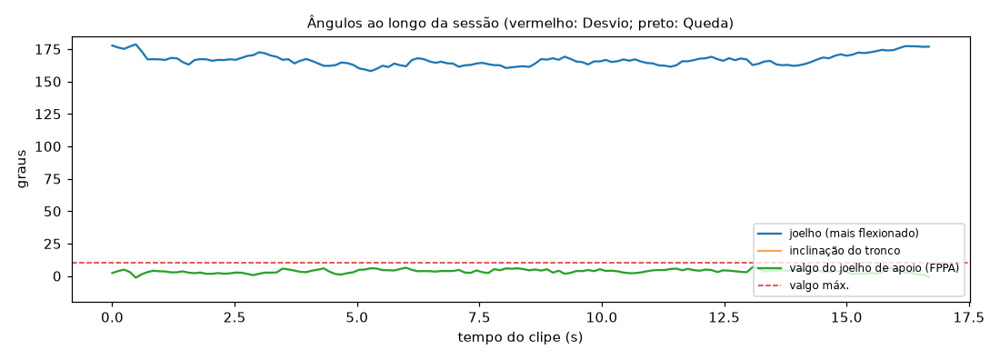

# Relatório de Sessão — unipodal_alinhado

- **Arquivo:** `unipodal_S1.ogv`
- **Paciente:** avulso
- **Cenário:** Agachamento unipodal (mini agachamento em uma perna)
- **Vista da câmera:** frontal
- **Duração:** 16.7 s (418 frames a 25 fps; pose em 1 a cada 3)
- **Processamento em CPU:** 8.7 s (0.52× o tempo do clipe)
- **Frames com pessoa detectada:** 100%

## Repetições (0)

Sem repetições segmentadas pelo joelho (exercício avaliado por episódio).

## Desvios de Execução (0)

Nenhum Desvio de Execução: execução dentro da faixa esperada.

## Quedas (0)

Nenhuma Queda detectada.

## Ângulos ao longo do tempo

_Gerado automaticamente pelo Analisador de Vídeo (YOLOv8n-pose). Limiares em `src/analyzers/video/exercise_rules.py` e `fall.py`._
