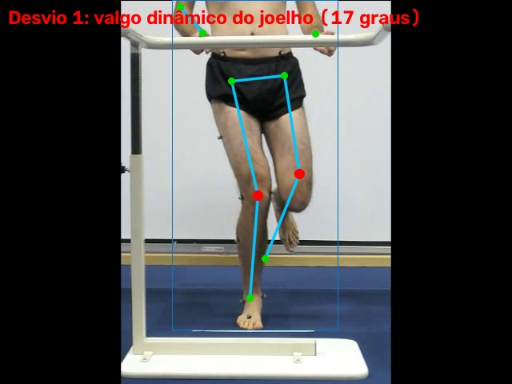
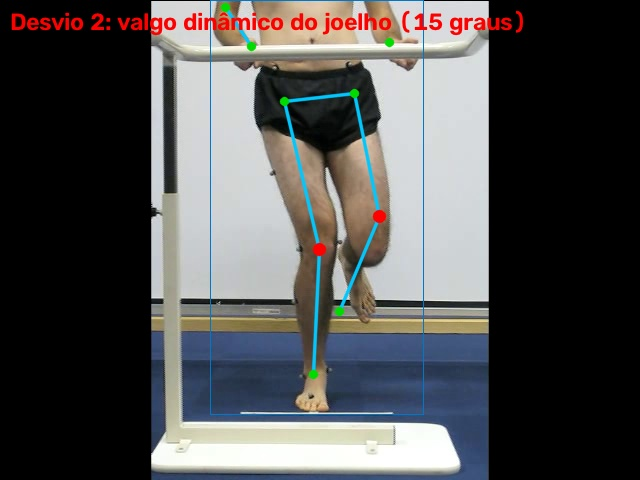
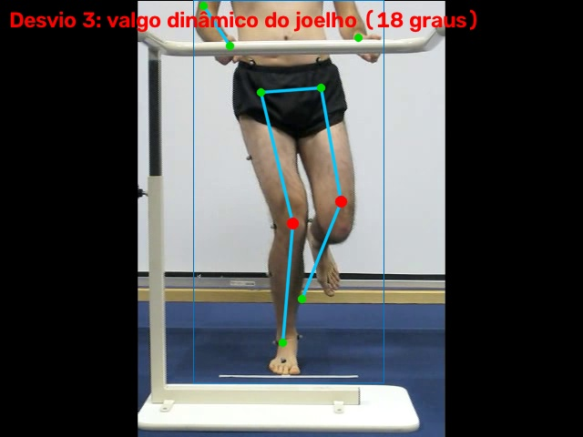
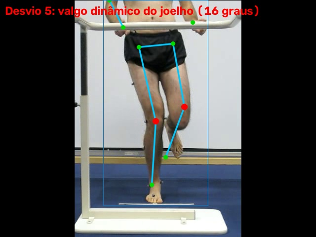
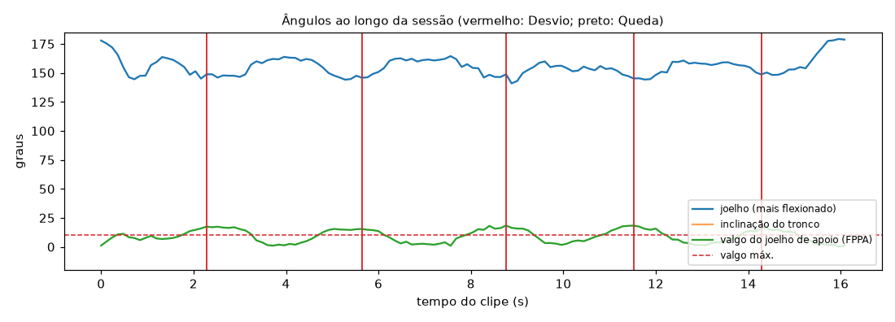

# Relatório de Sessão — unipodal_valgo

- **Arquivo:** `unipodal_S2.ogv`
- **Paciente:** demo-01
- **Cenário:** Agachamento unipodal (mini agachamento em uma perna)
- **Vista da câmera:** frontal
- **Duração:** 16.2 s (404 frames a 25 fps; pose em 1 a cada 3)
- **Processamento em CPU:** 7.9 s (0.49× o tempo do clipe)
- **Frames com pessoa detectada:** 100%

## Repetições (0)

Sem repetições segmentadas pelo joelho (exercício avaliado por episódio).

## Desvios de Execução (5)

| desvio | rep./episódio | instante | medido | esperado |
| --- | --- | --- | --- | --- |
| valgo dinâmico do joelho | 1 | 2.3 s | 17° | ≤ 10° |
| valgo dinâmico do joelho | 2 | 5.6 s | 15° | ≤ 10° |
| valgo dinâmico do joelho | 3 | 8.8 s | 18° | ≤ 10° |
| valgo dinâmico do joelho | 4 | 11.5 s | 18° | ≤ 10° |
| valgo dinâmico do joelho | 5 | 14.3 s | 16° | ≤ 10° |

## Quedas (0)

Nenhuma Queda detectada.

## Evidências

**Desvio 1: valgo dinâmico do joelho**

**Desvio 2: valgo dinâmico do joelho**

**Desvio 3: valgo dinâmico do joelho**

**Desvio 4: valgo dinâmico do joelho**

**Desvio 5: valgo dinâmico do joelho**

## Ângulos ao longo do tempo

_Gerado automaticamente pelo Analisador de Vídeo (YOLOv8n-pose). Limiares em `src/analyzers/video/exercise_rules.py` e `fall.py`._
